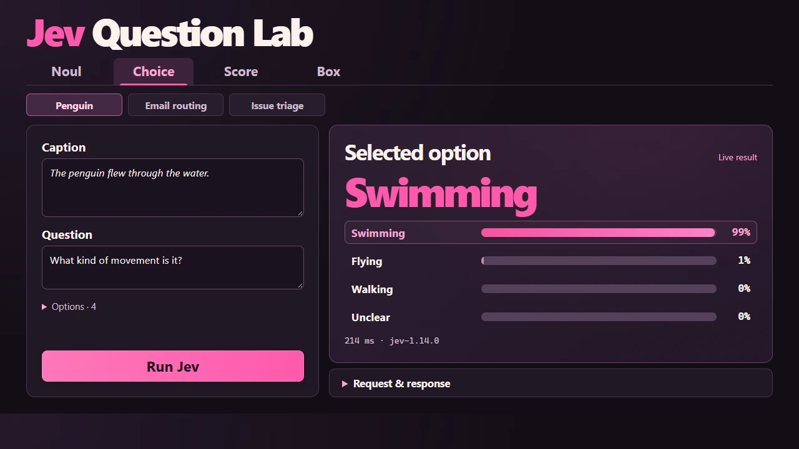

# Jev Question Lab

A browser demo for asking TypeSafe's Jev a focused question and seeing the answer your code can use. Try a built-in case, change the input or question, and open **Request & response** to see what went over the API.



## Run locally

You’ll need Node.js 22 or newer and a TypeSafe API key. [Download Node.js](https://nodejs.org/en/download) · [Manage TypeSafe keys](https://console.typesafe.ai/keys)

Create a `.env` file in the project folder with your key.

```dotenv
TYPESAFE_API_KEY=your_key_here
```

On Windows, open `Launch Question Lab.cmd`. To start it from a terminal, run the following command from the project folder and open [127.0.0.1:48176](http://127.0.0.1:48176/).

```sh
node server.cjs
```

The lab uses Node’s built-in modules, so there’s nothing to install. You can also set `TYPESAFE_API_KEY` in your shell. Git ignores `.env`.

## Try a case

Each tab opens with a penguin example and offers two other cases. Pick a case and click **Run Jev**. Edits take effect on your next run.

| Primitive | What Jev returns | Other cases |
| --- | --- | --- |
| **Noul** | The probability of a yes answer | Agent proof, send permission |
| **Choice** | A selected option and probabilities for the options | Email routing, issue triage |
| **Score** | A position on an ordered rubric | Bug reproducibility, handoff readiness |
| **Box** | A rectangle around the target in an image | Address label, vehicle damage |

A quick demo is **Noul → Send permission**. Open **Request & response** and run the original draft request. Replace “Draft” with “Send” and run again. Watch how changing one word affects the returned probability. [TypeSafe API reference](https://docs.typesafe.ai/api/system-one)

## How it works

The browser sends the input, question, and any criteria to the local Node server. The server keeps the API key, forwards the request to Jev, and returns the answer and elapsed time for the browser to display.

- [index.html](index.html) and [styles.css](styles.css) define the screen and its ready, running, and result states.
- [lab.js](lab.js) holds the cases, builds requests, and draws the four results.
- [server.cjs](server.cjs) serves the app locally and makes the authenticated TypeSafe calls.

## Photo credits

- Parcel label by Meanwell Packaging. [Photographer](https://meanwell-packaging.co.uk/) · [Source](https://commons.wikimedia.org/wiki/File:Sticking_a_label_onto_a_parcel_for_shipping.jpg) · [CC BY 2.0](https://creativecommons.org/licenses/by/2.0/)
- Vehicle damage by Nenad Stojković. [Source](https://commons.wikimedia.org/wiki/File:Car_damage_on_fender_observed_in_a_parking_lot.jpg) · [CC BY 2.0](https://creativecommons.org/licenses/by/2.0/)
